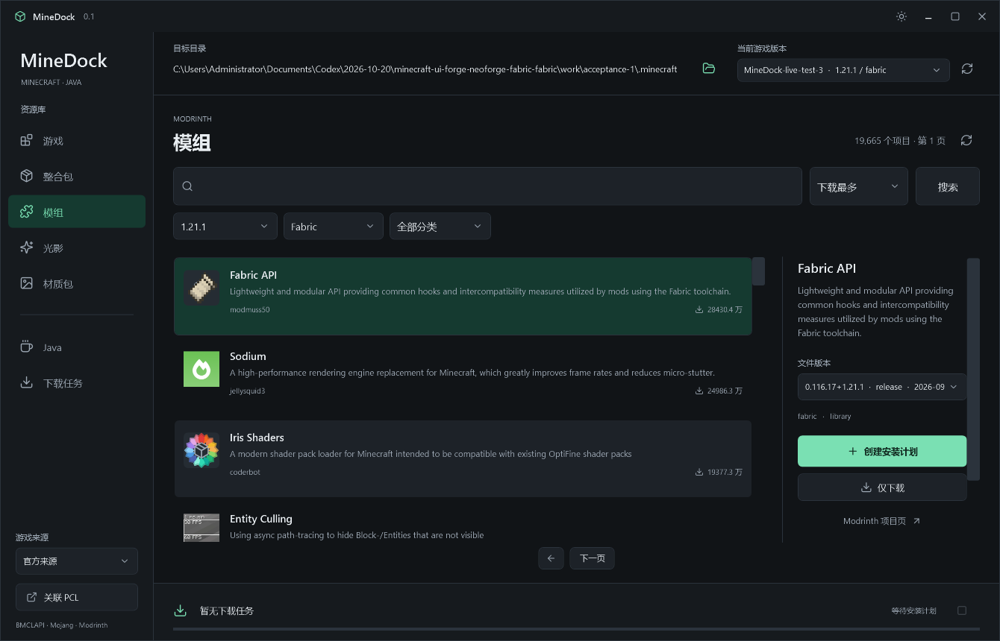
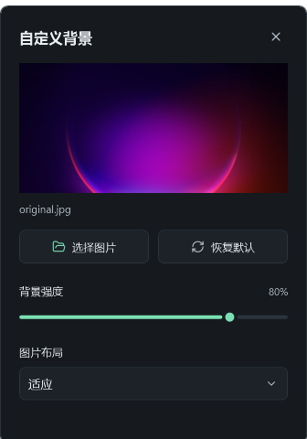

# MineDock

[简体中文](README.md) | [English](README.en.md)

A Windows desktop downloader and installer for Minecraft Java Edition, built with C#, .NET 10, and WPF.

> This project was created entirely through "wish-driven programming" with an AI coding assistant. The developer is almost a complete beginner in the relevant fields.

## Downloads

Current version: **v0.1.1**.

- [Windows x64 portable build](https://github.com/EnchantGapple233/Minedock/releases/download/v0.1.1/MineDock-0.1.1-win-x64.zip)
- [Release notes and checksums](https://github.com/EnchantGapple233/Minedock/releases/tag/v0.1.1)
- [All releases](https://github.com/EnchantGapple233/Minedock/releases)

Extract the ZIP and run `MineDock.exe`. The .NET runtime is included. The application targets Windows 10 / 11 x64; it has only been tested on Windows 11 x64 so far.

## Features

- Install official Minecraft Java releases, including the client, libraries, native library archives, assets, and logging configuration.
- Install stable Fabric Loader versions and the matching Fabric API.
- Search Modrinth for mods, modpacks, shaders, and resource packs, with game version, loader, and category filters appropriate to each section.
- Resolve required mod dependencies and show their names, versions, and files before installation.
- Install mods and resource packs; generate Fabric shader installation plans that include Iris and its declared dependencies.
- Download original modpack files.
- Install official Eclipse Temurin Windows x64 JRE / JDK builds into separate version directories.
- Read PCL's instance isolation settings to select the appropriate resource directory.
- Download caching, segmented transfers and resuming, cancellation and retries, task history, hash verification, rollback, and recovery after interruption.
- Light and dark themes, a Chinese-language interface, independent section filters, and an installation plan panel.
- Custom PNG, JPEG, WebP, or BMP backgrounds, with intensity, fill / fit layout, and restore-default controls.



## Usage

1. Select the target `.minecraft` folder and optionally associate the actual PCL executable.
2. Choose a Minecraft and Fabric version to install, or an existing game instance when adding content.
3. Search and filter content, create an installation plan, and review files, dependencies, download sizes, and destinations before confirming.
4. Use PCL for account login, game launching, isolation settings, and management of existing mods.

Before installing into a target directory, close its running game and finish any PCL installation task using that directory. MineDock only reads PCL settings and stops resource installation when it cannot determine the isolation policy.

Java defaults to `%APPDATA%\.minecraft\runtime\MineDock`. After installation, let PCL search for Java or manually select the relevant `bin\java.exe`. MineDock does not modify `PATH` or `JAVA_HOME`.

### Custom Backgrounds

Use the image button at the top right of the title bar to select a background. The image, intensity, and layout settings are saved automatically and survive moving the original file. Restoring defaults does not delete the original. Images up to 64 MB and 40 megapixels are supported; cached images are limited to 2560 pixels on the longest edge. Light and dark themes adapt the displayed background strength to preserve text readability.



## Download Sources

| Content | Source |
| --- | --- |
| Minecraft client, libraries, and assets | Mojang official servers / BMCLAPI |
| Fabric | Official Fabric metadata and Maven |
| Mods, modpacks, shaders, and resource packs | Modrinth |
| Java | Official Eclipse Adoptium Temurin distribution |

The game source can be automatic, official, or BMCLAPI. Automatic mode tries BMCLAPI first for supported Mojang domains and falls back to official servers on failure. A locked source does not switch automatically. Other services retain their own official distribution sources.

## Current Scope

This is the first phase of the project. Full installers for Forge, NeoForge, Quilt, QSL, Legacy Fabric, and OptiFine, automatic `.mrpack` installation, and game-directory ZIP import / extraction are **not implemented yet**. The modpack section currently supports search, filtering, and downloading original files.

Account login, game launching, mod enabling / disabling, and uninstalling are handled by the launcher. Compatibility checks use game versions, loaders, declared dependencies, and known conflicts; they cannot rule out every runtime conflict.

## Data and Verification

- Settings, history, caches, installation plans, and transaction journals are stored in `%LOCALAPPDATA%\MineDock`.
- Files are committed to the target directory only after download and upstream hash verification.
- Existing files are backed up before replacement. Failed or cancelled operations can roll back; interrupted transactions can recover while protecting files changed by other programs.
- Minecraft, mods, modpacks, and Java are downloaded from their upstream providers when requested and are not bundled with MineDock.

## Building

Install the .NET 10 SDK on Windows x64, then run from the repository root:

```powershell
dotnet build MineDock.slnx -c Release
dotnet run --project .\MineDock.Checks\MineDock.Checks.csproj -c Release -- .\check-output
dotnet publish .\MineDock.App\MineDock.App.csproj -c Release -r win-x64 --self-contained true -o .\artifacts\publish
```

Append `--live` to the check command to exercise upstream APIs. `--live --install` downloads approximately 1 GB and installs Minecraft 1.21.1, Fabric, Fabric API, and Java 21 into the specified test directory. `--live --mirror` checks BMCLAPI separately.

Diagnostic screenshots: `MineDock.exe --capture <absolute-output-directory>`. Set `MINEDOCK_DATA` to keep diagnostic data separate from your normal settings.

## Validation Status

Actual installation of Minecraft 1.21.1, Fabric, Fabric API, and Java has been verified, with 65 checks passing in the full workflow. A separate set of 62 local and online checks overlaps with that set and must not be added to it as a total.

The v0.1.1 background update passed 20 focused checks and 5 portable startup checks. The full game download was not repeated for this update.

Launching the installed game through a genuine PCL executable and running on Windows 10 have not been verified. BMCLAPI checks retrieved the version manifest and one asset successfully; certificate failures on some distribution nodes prevented validation of a complete mirror installation.

See [validation notes](VALIDATION.md), currently in Chinese, and the [changelog](CHANGELOG.md).

## License

MineDock is licensed under [GPL-3.0-or-later](LICENSE). See [THIRD-PARTY-NOTICES.md](THIRD-PARTY-NOTICES.md) for component licenses and upstream sources. Downloaded content retains its own license.
