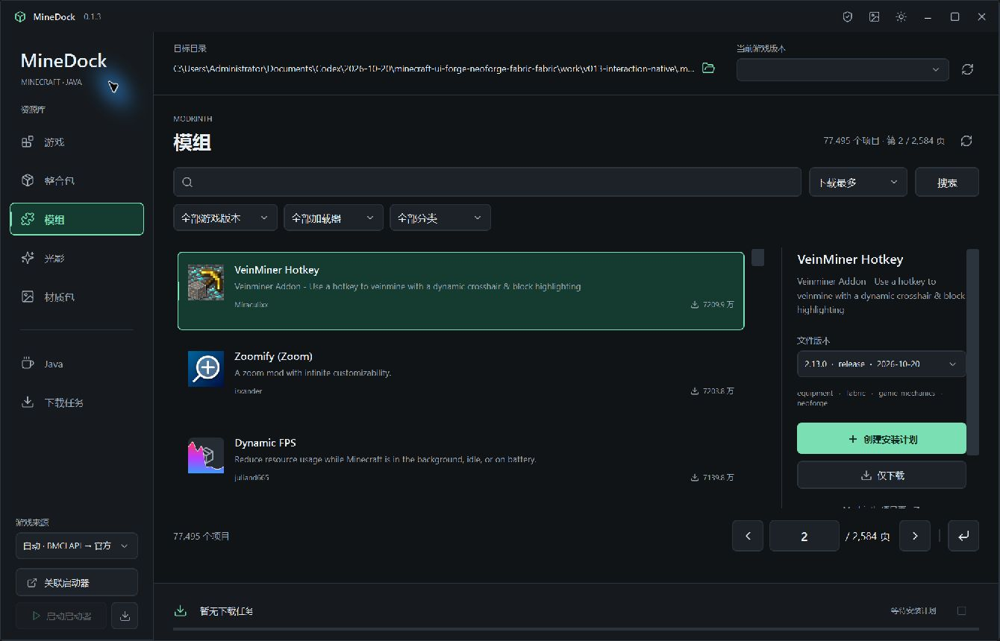
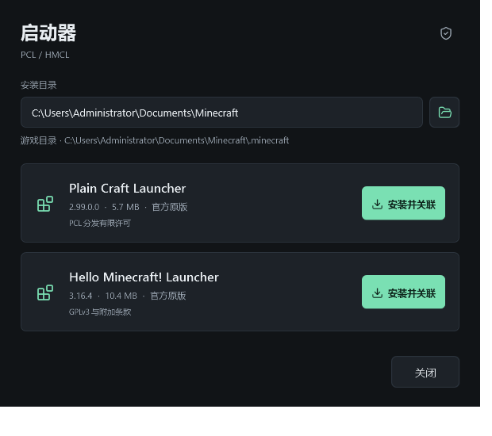

# MineDock

[简体中文](README.md) | [English](README.en.md)

Minecraft Java 版的 Windows 桌面下载与安装工具，使用 C#、.NET 10 和 WPF 开发。

> 本项目完全源于许愿式编程，开发者在相关知识方面几乎是纯小白。十分感激各位大佬锐评指导。
>
> This project was created entirely through "wish-driven programming" with an AI coding assistant. The developer is almost a complete beginner in the relevant fields. Feedback and guidance are greatly appreciated.

## 下载

当前版本：**v0.1.3**，提供自带运行环境的 Windows x64 单 EXE。

- [直接下载 MineDock.exe](https://github.com/EnchantGapple233/Minedock/releases/download/v0.1.3/MineDock.exe)
- [Windows x64 便携 ZIP](https://github.com/EnchantGapple233/Minedock/releases/download/v0.1.3/MineDock-0.1.3-win-x64.zip)
- [完整源码 ZIP](https://github.com/EnchantGapple233/Minedock/releases/download/v0.1.3/MineDock-0.1.3-source.zip)
- [版本说明与校验文件](https://github.com/EnchantGapple233/Minedock/releases/tag/v0.1.3)
- [全部版本](https://github.com/EnchantGapple233/Minedock/releases)

直接运行 `MineDock.exe`，或将便携 ZIP 解压后运行其中的同一文件，无需额外安装 .NET。程序面向 Windows 10 / 11 x64，目前只在 Windows 11 x64 实机验证。

### 0.1.3 更新

- 在 MineDock 中打开已关联的 PCL / HMCL，或离线安装内置启动器并自动关联游戏目录。
- 侧栏与列表行悬停上浮、显示阴影，点击选中变色，移开后平滑落下。
- 四类 Modrinth 资源分别缓存，切换栏目恢复筛选、页码、选择与滚动位置；列表可跨重启保留 24 小时。

完整变更见[更新日志](CHANGELOG.md)。

## 功能

- 下载并安装 Minecraft 原版正式版，包含客户端、支持库、原生库包、资源文件和日志配置。
- 安装 Fabric 稳定版，并按游戏版本补齐 Fabric API。
- 从 Modrinth 搜索模组、整合包、光影和材质包，按游戏版本、加载器和当前栏目的内容分类等条件筛选。
- 解析模组的必需依赖，在安装确认前展示待补齐的名称、版本和文件。
- 安装模组和材质包；为 Fabric 光影生成包含 Iris 及声明依赖的安装计划。
- 下载整合包原始文件。
- 安装 Eclipse Temurin Windows x64 JRE / JDK，支持选择主版本和多版本独立目录。
- 关联 PCL 或 HMCL 后自动选择游戏目录，读取启动器的隔离与自定义运行目录设置，将资源写入对应位置。
- 下载缓存、大文件分段与断点续传、取消和重试、任务记录、哈希校验、安装失败回滚及中断恢复。
- 明暗主题、中文界面、栏目独立筛选和安装计划面板。
- 自定义背景图片，支持 PNG、JPEG、WebP、BMP，可调整背景强度、选择填充或适应，并恢复默认。
- Modrinth 当前页与总页数显示、对称的翻页按钮、指定页跳转，以及无效输入、加载与失败状态处理。
- 更清晰的页码、选项悬停上浮与柔和阴影、移开落下、选中变色、按下反馈及键盘焦点提示。
- 分栏目缓存搜索结果，返回时保留筛选、页码、选中项、文件版本和滚动位置，避免每次切换都重新加载列表。
- 直接打开关联的 PCL / HMCL，支持 EXE 和 HMCL JAR。
- 内置 PCL 2.99.0.0 与 HMCL 3.16.4 官方原版 EXE，可离线安装并自动关联；支持自带运行时的单 EXE 分发。
- 程序内可查看第三方许可，并离线导出 HMCL 与 HMCLauncher 的对应源码。



## 使用

1. 点击「关联启动器」选择现有 PCL.exe、HMCL.exe 或 HMCL.jar；也可用左下角下载图标安装并关联内置启动器。程序优先读取已配置的游戏目录，否则识别启动器旁的 `.minecraft`；未找到时可手动选择。
2. 安装游戏时选择 Minecraft 和 Fabric 版本；添加资源时选择已安装的游戏实例。
3. 搜索并筛选内容，创建安装计划，检查文件、依赖、下载大小和目标位置后确认执行。
4. 点击左下角「启动 PCL / HMCL」打开已关联启动器，再由启动器完成账号登录、游戏启动、隔离设置和已有模组管理。

向目标目录安装内容时，应先结束对应游戏，以及启动器中对同一目录执行的安装任务。MineDock 只读启动器配置，无法确认资源目录时会停止安装。更换启动器或游戏目录会清除原待安装计划。

Java 默认安装到 `%APPDATA%\.minecraft\runtime\MineDock`。安装后可在 PCL / HMCL 中搜索 Java，或手动导入对应版本的 `bin\java.exe`。程序不会修改 `PATH` 或 `JAVA_HOME`。

### 安装与打开启动器

点击左下角的下载图标，选择启动器安装目录，再点击 PCL 或 HMCL 的「安装并关联」。两份 EXE 均已随程序内置，此步骤不需要联网；选择的目录中会保留启动器，并创建或复用同目录下的 `.minecraft`。已有相同文件会直接复用，已有不同版本不会被覆盖。



安装完成后自动关联。已有启动器仍可通过「关联启动器」选择；启动时使用其所在目录作为工作目录，不向游戏注入登录信息或命令。HMCL JAR 需要 Java 17 或更高版本，可使用 MineDock 安装的运行环境；找不到时可手动选择 `javaw.exe` / `java.exe`。

离线安装指将内置 EXE 写入选定目录。HMCL 首次运行仍可能获取 Java 或 JavaFX，账号登录和游戏下载也可能需要联网。

### 单 EXE

v0.1.3 只需一个 `MineDock.exe`，无需安装 .NET。首次运行时 .NET 会将运行时及原生组件展开到临时缓存，设置和下载数据仍保存在应用数据目录。安装出的启动器及 `.minecraft` 会保留在用户选择的位置。

顶部盾牌图标提供许可查看与 HMCL 对应源码导出。分发文件只有一个 EXE，不代表程序运行时不会创建缓存或安装文件。

### 启动器兼容

保留已有 PCL 关联设置，支持 PCL 的便携目录写法。HMCL 同时支持旧版 `hmclversion.cfg` / `hmcl.json`，以及 3.16 系列的目录列表、游戏设置预设与实例运行目录。配置存在歧义、损坏或不支持的版本时会提示，保留「仅下载」。

默认按启动器所在文件夹解析相对路径；HMCL 使用环境变量指定配置位置时也会读取。通过快捷方式或脚本指定了其他工作目录或 JVM 配置路径的特殊启动方式，需要先核对实际目录。详情见[启动器兼容说明](docs/LAUNCHER-COMPATIBILITY.md)。

### 分页与跳转

搜索结果下方显示总项目数、当前页和总页数。使用左右箭头翻页；编辑页码后按 Enter 或点击跳转图标，按 Esc 可恢复当前页码。首页、末页、加载中和空结果时会禁用不可用操作。无效页码在分页区提示，网络失败时保留已有结果与页码。用新条件执行搜索时从第一页开始。

### 自定义背景

点击标题栏右上角的图片按钮选择背景。图片、强度和布局设置会自动保存；移动原图后仍可显示，恢复默认不会删除原图。支持最大 64 MB、4000 万像素的图片，缓存最长边不超过 2560 像素。明暗主题会分别控制背景显示强度，以保持文字可读。


### 列表缓存

模组、整合包、光影和材质包首次获取成功后分别缓存，切换回来直接显示上次内容。当前会话会复用最近查看的文件版本，已加载的图标不会因栏目切换而重新闪烁。

列表还会保存到 `%LOCALAPPDATA%\MineDock\catalog-cache`，24 小时内重新打开程序可恢复上次列表；新窗口首次选中项目时会单独获取其文件版本。点击栏目右上角刷新，或执行新搜索，可获取新结果；刷新保留当前页，新搜索从第一页开始。更换目标游戏或加载器后重新按目标筛选。损坏、过期或无法写入的缓存不会阻止正常搜索。

## 下载来源

| 内容 | 来源 |
| --- | --- |
| Minecraft 客户端、支持库和资源 | Mojang 官方 / BMCLAPI |
| Fabric | Fabric 官方接口与 Maven |
| 模组、整合包、光影、材质包 | Modrinth |
| Java | Eclipse Adoptium Temurin 官方分发 |

游戏来源可选择自动、官方或 BMCLAPI。自动模式对支持的 Mojang 下载域名优先使用 BMCLAPI，失败后回退官方；锁定来源时不会自动切换。其他服务保留各自的官方分发来源。

## 当前范围

当前是第一阶段版本。Forge、NeoForge、Quilt、QSL、Legacy Fabric、OptiFine 的完整安装，以及整合包 `.mrpack` 自动安装和游戏目录 ZIP 导入 / 解包，**尚未实现**。整合包页面目前支持搜索、筛选和原始文件下载。

账号登录、游戏实际启动、模组启停和卸载仍由启动器处理；MineDock 提供打开启动器的入口。兼容性检查依据游戏版本、加载器、声明依赖及已知冲突，不能保证排除所有运行时冲突。

## 数据与校验

- 设置、历史、下载缓存、计划和事务日志位于 `%LOCALAPPDATA%\MineDock`。
- 下载完成并通过上游哈希校验后，才会提交文件到目标目录。
- 覆盖已有文件前会备份；失败、取消或异常退出后可回滚或恢复，并保护外部程序修改过的文件。
- 游戏、模组、整合包和 Java 不随本程序分发，由用户执行下载时从对应上游获取。内置的 PCL / HMCL 是独立的原版启动器，保留各自许可。

## 构建

在 Windows x64 安装 .NET 10 SDK，然后在仓库根目录执行：

```powershell
dotnet build MineDock.slnx -c Release
dotnet run --project .\MineDock.Checks\MineDock.Checks.csproj -c Release -- .\check-output
dotnet run --project .\MineDock.UiChecks\MineDock.UiChecks.csproj -c Release -- .\check-output-ui
dotnet publish .\MineDock.App\MineDock.App.csproj -c Release -r win-x64 --self-contained true -o .\artifacts\publish
dotnet publish .\MineDock.App\MineDock.App.csproj -c Release -p:PublishProfile=SingleFile -o .\artifacts\single-file
```

在线检查可在检查命令最后加 `--live`；`--live --install` 会下载约 1 GB，并在指定测试目录实际安装 Minecraft 1.21.1、Fabric、Fabric API 和 Java 21。`--live --mirror` 可单独检查 BMCLAPI。

`MineDock.UiChecks` 在独立应用数据目录运行实际 WPF 分页、文字边界、悬停与选中反馈、列表缓存和启动器关联 / 安装检查；加 `--live` 可验证四个 Modrinth 栏目的真实翻页与末页访问，并生成明暗主题及最小窗口截图。

诊断截图：`MineDock.exe --capture <绝对输出目录>`。可设置 `MINEDOCK_DATA` 环境变量，将诊断数据与日常使用的设置分开。

## 验证状态

已完成 Minecraft 1.21.1、Fabric、Fabric API 和 Java 的实际安装验证，完整流程 65 项检查通过。另有包含重叠项目的 62 项本地及在线检查，不能与前一组相加。

v0.1.1 新增背景功能的 20 项专项检查及便携版的 5 项启动检查通过，本次未重复执行完整游戏下载。

v0.1.2 的 55 项分页与在线界面检查、92 项核心与启动器检查、20 项背景回归检查和 5 项便携程序启动检查通过，覆盖真实分页、八位页码文字边界、选中反馈、目录自动关联、HMCL 新旧配置和最小窗口布局。本次未重复执行约 1 GB 的完整游戏安装。

v0.1.3 的 141 项界面与启动器检查通过，覆盖悬停上浮、移开复位、缓存复用、跨窗口恢复、刷新、损坏 / 过期缓存及异步切换。92 项核心检查与 20 项背景回归检查也已通过。最终单 EXE 在独立目录完成在线列表、图标、分页恢复和正常退出检查；首次 0.1.3 候选版已实际打开两份内置启动器及安装、许可窗口，HMCL 对应源码可离线导出。此次仍未重复完整游戏安装。

已检查官方 HMCL 3.16.4 EXE / JAR 的文件识别，配置兼容依据官方源码与本地配置样例验证。尚未完成真实 PCL / HMCL 启动游戏的实机验证，也未在 Windows 10 实机测试。BMCLAPI 已验证版本清单及一个资源文件，部分分发节点的证书错误导致完整镜像安装未获验证。

详见 [验证记录](VALIDATION.md) 和 [更新日志](CHANGELOG.md)。

## 许可

MineDock 源码使用 [GPL-3.0-or-later](LICENSE)。原样随附的 PCL 使用 PCL 分发有限许可，HMCL / HMCLauncher 使用 GPLv3 及各自附加条款，其他第三方组件保留原有许可。完整声明与上游来源见 [THIRD-PARTY-NOTICES.md](THIRD-PARTY-NOTICES.md)，启动器版本及哈希见[随附来源记录](MineDock.App/Assets/Launchers/SOURCES.md)。
