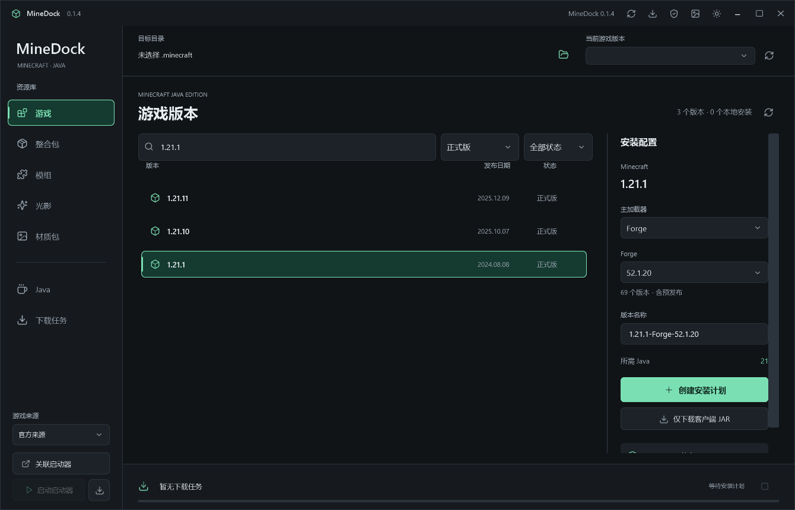

# MineDock 使用指南

[返回首页](../README.md) | [English](USER-GUIDE.en.md)

本指南说明 v0.1.4 的功能、操作、下载来源和已知限制。版本变化见[更新日志](../CHANGELOG.md)，构建与检查命令见[开发指南](DEVELOPMENT.md)，历史实测结果见[验证记录](../VALIDATION.md)。

## 功能

- 下载并安装 Minecraft 原版正式版、快照及历史版本，包含客户端、支持库、原生库包、资源文件和日志配置。
- 安装七类加载器的兼容版本，包括预发布；可按游戏版本补齐 Fabric API。
- 从 Modrinth 搜索模组、整合包、光影和材质包，按游戏版本、加载器和当前栏目的内容分类等条件筛选。
- 解析模组的必需依赖，在安装确认前展示待补齐的名称、版本和文件。
- 安装模组和材质包；为 Fabric 光影生成包含 Iris 及声明依赖的安装计划。
- 下载整合包原始文件。
- 安装 Eclipse Temurin Windows x64 JRE / JDK，支持选择主版本和多版本独立目录。
- 关联 PCL 或 HMCL 后自动选择游戏目录，读取启动器的隔离与自定义运行目录设置，将资源写入对应位置。
- 下载缓存、大文件分段与断点续传、取消和重试、任务记录、哈希校验、安装失败回滚及中断恢复。
- 明暗主题、中文界面、栏目独立筛选和安装计划面板。
- 自定义背景图片，支持 PNG、JPEG、WebP、BMP，可调整背景强度、选择填充或适应，并恢复默认。
- Modrinth 当前页与总页数显示、对称的翻页按钮、指定页跳转，以及无效输入、加载与失败状态处理。
- 更清晰的页码、选项悬停上浮与柔和阴影、移开落下、选中变色、按下反馈及键盘焦点提示。
- 分栏目缓存搜索结果，返回时保留筛选、页码、选中项、文件版本和滚动位置，避免每次切换都重新加载列表。
- 直接打开关联的 PCL / HMCL，支持 EXE 和 HMCL JAR。
- 内置 PCL 2.99.0.0 与 HMCL 3.16.4 官方原版 EXE，可离线安装并自动关联；支持自带运行时的单 EXE 分发。
- 程序内可查看第三方许可，并离线导出 HMCL 与 HMCLauncher 的对应源码。

## 使用

1. 点击「关联启动器」选择现有 PCL.exe、HMCL.exe 或 HMCL.jar；也可用左下角下载图标安装并关联内置启动器。程序优先读取已配置的游戏目录，否则识别启动器旁的 `.minecraft`；未找到时可手动选择。
2. 安装游戏时选择 Minecraft、加载器及具体版本；添加资源时选择已安装的游戏实例。
3. 搜索并筛选内容，创建安装计划，检查文件、依赖、下载大小和目标位置后确认执行。
4. 点击左下角「启动 PCL / HMCL」打开已关联启动器，再由启动器完成账号登录、游戏启动、隔离设置和已有模组管理。

向目标目录安装内容时，应先结束对应游戏，以及启动器中对同一目录执行的安装任务。MineDock 只读启动器配置，无法确认资源目录时会停止安装。更换启动器或游戏目录会清除原待安装计划。

Java 默认安装到 `%APPDATA%\.minecraft\runtime\MineDock`。安装后可在 PCL / HMCL 中搜索 Java，或手动导入对应版本的 `bin\java.exe`。程序不会修改 `PATH` 或 `JAVA_HOME`。

### 安装与打开启动器

点击左下角的下载图标，选择启动器安装目录，再点击 PCL 或 HMCL 的「安装并关联」。两份 EXE 均已随程序内置，此步骤不需要联网；选择的目录中会保留启动器，并创建或复用同目录下的 `.minecraft`。已有相同文件会直接复用，已有不同版本不会被覆盖。

安装完成后自动关联。已有启动器仍可通过「关联启动器」选择；启动时使用其所在目录作为工作目录，不向游戏注入登录信息或命令。HMCL JAR 需要 Java 17 或更高版本，可使用 MineDock 安装的运行环境；找不到时可手动选择 `javaw.exe` / `java.exe`。

离线安装指将内置 EXE 写入选定目录。HMCL 首次运行仍可能获取 Java 或 JavaFX，账号登录和游戏下载也可能需要联网。

### 单 EXE

自 v0.1.3 起，发行版只需一个 `MineDock.exe`，无需安装 .NET。首次运行时 .NET 会将运行时及原生组件展开到临时缓存，设置和下载数据仍保存在应用数据目录。安装出的启动器及 `.minecraft` 会保留在用户选择的位置。

顶部盾牌图标提供许可查看与 HMCL 对应源码导出。分发文件只有一个 EXE，不代表程序运行时不会创建缓存或安装文件。

### 加载器与版本

「主加载器」提供 Forge、NeoForge、Fabric、Quilt、OptiFine、Legacy Fabric、LiteLoader。版本列表可选择上游发布的兼容版本，包括预发布；默认优先最新稳定版。各加载器支持范围由上游决定，没有发布兼容版本时不能安装。

Fabric、Quilt、Legacy Fabric 使用各自 Meta 接口；其余加载器由内置 HMCL 3.16.4 的安装引擎在临时目录执行，再提交配置与支持库。引擎需要 JDK 21+ 和 OpenJFX；游戏要求更高的 Java 时沿用其要求，缺少时在计划中加入对应 Temurin JDK。安装器、处理依赖可能在执行阶段继续联网下载，计划显示的初始大小不包含这部分。日志位于 `%LOCALAPPDATA%\MineDock\loader-logs`。

Fabric API 保留可选补齐。QSL / QFAPI 等 API 可在模组页面按已安装实例筛选安装；本次不支持多个主加载器叠加。

LiteLoader 快照按官方 Maven 元数据解析实际构建并核对 SHA-1，避免依赖已失效的镜像节点；旧 ASM 支持库使用 Maven Central。

### 程序自动更新

标题栏更新图标可手动检查或关闭「自动下载并更新」，设置跨重启保留。默认启动时及每小时检查 `EnchantGapple233/Minedock` 的最新正式 GitHub Release；不使用预发布，不降级。下载单 EXE 后核对大小及 GitHub SHA-256，旧发行版可回退使用 `SHA256SUMS.txt`。

新版本下载完会显示状态并等待 10 秒，当前任务、安装计划和子窗口关闭后自动替换并重启。助手先保留原 EXE，等待新窗口就绪；替换或启动失败会保留或恢复原程序。无网络、限流、无写入权限或校验失败不会覆盖当前版本。更新数据与结果保存在 `%LOCALAPPDATA%\MineDock\updates`。自动替换适用于发行版单 EXE；开发构建只检查和下载。

### 启动器兼容

保留已有 PCL 关联设置，支持 PCL 的便携目录写法。HMCL 同时支持旧版 `hmclversion.cfg` / `hmcl.json`，以及 3.16 系列的目录列表、游戏设置预设与实例运行目录。配置存在歧义、损坏或不支持的版本时会提示，保留「仅下载」。

默认按启动器所在文件夹解析相对路径；HMCL 使用环境变量指定配置位置时也会读取。通过快捷方式或脚本指定了其他工作目录或 JVM 配置路径的特殊启动方式，需要先核对实际目录。详情见[启动器兼容说明](LAUNCHER-COMPATIBILITY.md)。

### 分页与跳转

搜索结果下方显示总项目数、当前页和总页数。使用左右箭头翻页；编辑页码后按 Enter 或点击跳转图标，按 Esc 可恢复当前页码。首页、末页、加载中和空结果时会禁用不可用操作。无效页码在分页区提示，网络失败时保留已有结果与页码。用新条件执行搜索时从第一页开始。

### 自定义背景

点击标题栏右上角的图片按钮选择背景。图片、强度和布局设置会自动保存；移动原图后仍可显示，恢复默认不会删除原图。支持最大 64 MB、4000 万像素的图片，缓存最长边不超过 2560 像素。明暗主题会分别控制背景显示强度，以保持文字可读。

### 列表缓存

模组、整合包、光影和材质包首次获取成功后分别缓存，切换回来直接显示上次内容。当前会话会复用最近查看的文件版本，已加载的图标不会因栏目切换而重新闪烁。

列表还会保存到 `%LOCALAPPDATA%\MineDock\catalog-cache`，24 小时内重新打开程序可恢复上次列表；新窗口首次选中项目时会单独获取其文件版本。点击栏目右上角刷新，或执行新搜索，可获取新结果；刷新保留当前页，新搜索从第一页开始。更换目标游戏或加载器后重新按目标筛选。损坏、过期或无法写入的缓存不会阻止正常搜索。

程序首屏显示后，会在后台依次预加载分类、模组 / 整合包 / 光影 / 材质包第一页，以及每栏最多 6 个图标。已有有效缓存直接复用；切换到正在预加载的栏目时共用同一次请求。预加载不改变当前筛选和页面，安装或准备计划时暂停后续请求，关闭窗口时取消；失败后仍可正常重试。它只准备浏览数据，不会自动下载游戏、模组文件或 Java。

## 下载来源

| 内容 | 来源 |
| --- | --- |
| Minecraft 客户端、支持库和资源 | Mojang 官方 / BMCLAPI |
| Fabric | Fabric 官方接口与 Maven |
| Quilt / Legacy Fabric | 对应官方 Meta 与 Maven |
| Forge / NeoForge | BMCLAPI 版本索引，HMCL 引擎按来源设置获取安装器与依赖 |
| OptiFine / LiteLoader | BMCLAPI 及 HMCL 引擎的兼容分发接口 |
| 模组、整合包、光影、材质包 | Modrinth |
| Java | Eclipse Adoptium Temurin 官方分发 |
| MineDock 更新 | 本仓库 GitHub Releases |

游戏来源可选择自动、官方或 BMCLAPI。自动模式对支持的 Mojang 下载域名优先使用 BMCLAPI，失败后回退官方；锁定来源时不会自动切换。其他服务保留各自的官方分发来源。

## 当前范围

整合包 `.mrpack` 自动安装和游戏目录 ZIP 导入 / 解包**尚未实现**。整合包页面目前支持搜索、筛选和原始文件下载。加载器列表涵盖上述七类，不表示每个历史构建仍可从上游下载，也不保证任意加载器组合兼容。

账号登录、游戏实际启动、模组启停和卸载仍由启动器处理；MineDock 提供打开启动器的入口。兼容性检查依据游戏版本、加载器、声明依赖及已知冲突，不能保证排除所有运行时冲突。

## 数据与校验

- 设置、历史、下载缓存、计划和事务日志位于 `%LOCALAPPDATA%\MineDock`。
- MineDock 计划中的远程文件通过上游哈希校验后才提交；HMCL 按其引擎规则校验加载器依赖，生成文件另以本地 SHA-256 校验后提交。本地校验用于防止暂存文件变化，不等同于上游签名。
- 覆盖已有文件前会备份；失败、取消或异常退出后可回滚或恢复，并保护外部程序修改过的文件。
- 游戏、模组、整合包和 Java 不随本程序分发，由用户执行下载时从对应上游获取。内置的 PCL / HMCL 是独立的原版启动器，保留各自许可。

## 网络与问题反馈

游戏清单加载失败时，先检查网络和来源设置，再用标题栏刷新按钮重试；筛选无结果时检查版本类型、关键词及加载器的上游支持范围。整合包目前只能下载原始文件，尚不支持自动安装 `.mrpack`。

使用疑问、兼容性讨论和网络连接问题请到 [Discussions](https://github.com/EnchantGapple233/Minedock/discussions)。可以稳定复现的程序错误请填写 [Bug 报告](https://github.com/EnchantGapple233/Minedock/issues/new?template=bug_report.yml)，注明 MineDock / Windows / 游戏 / 加载器版本、下载来源和复现步骤。提供日志或截图前，移除令牌、账号、个人路径与私密链接。

GitHub 无法连接时，程序自动更新可能失败，但不会替换当前版本。可以继续使用已有程序，并在恢复连接后从[官方 Releases](https://github.com/EnchantGapple233/Minedock/releases) 下载。第三方代理不属于本项目的官方更新来源，不能保证持续可用。

## 许可

MineDock 源码使用 [GPL-3.0-or-later](../LICENSE)。原样随附的 PCL 使用 PCL 分发有限许可，HMCL / HMCLauncher 使用 GPLv3 及各自附加条款，其他第三方组件保留原有许可。完整声明与上游来源见 [THIRD-PARTY-NOTICES.md](../THIRD-PARTY-NOTICES.md)，启动器版本及哈希见[随附来源记录](../MineDock.App/Assets/Launchers/SOURCES.md)。
